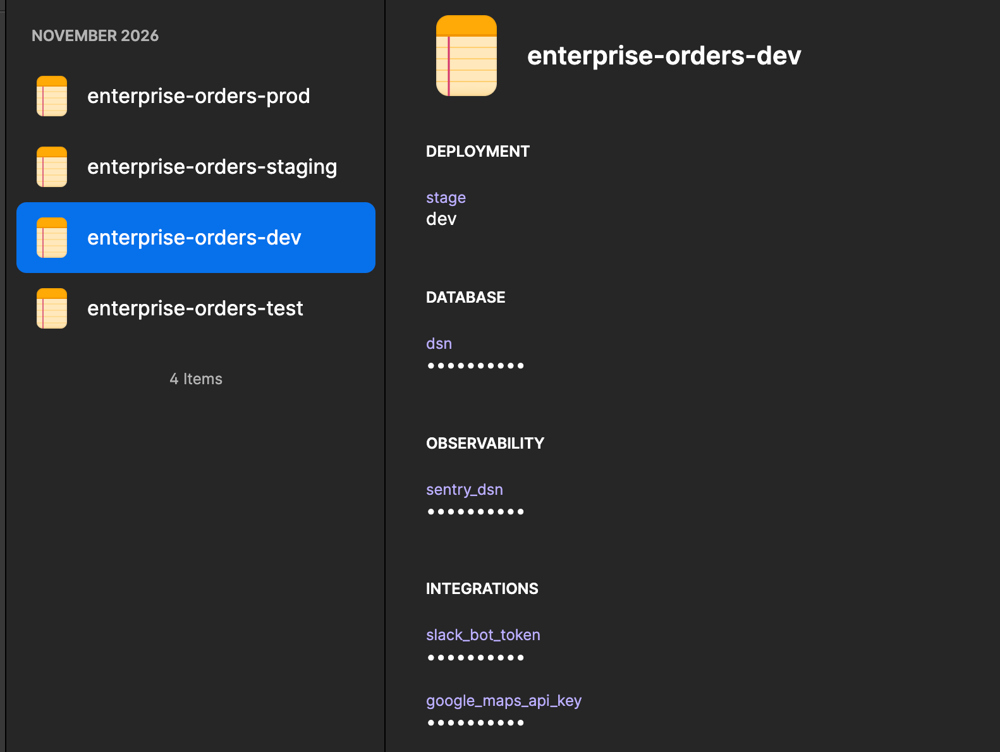

# 1Password CLI Secrets Demo

Keep your team's development secrets in a shared **1Password Environment**.
Each developer signs in with their own 1Password account and starts the app
with `op run`.

The demo is a small Python order service that checks synthetic credentials for
PostgreSQL, Sentry, Slack, and Google Maps. It prints a startup summary and
makes no network connections. If your team uses 1Password vault items or needs
a configuration file, see the [`.env` and JSON examples](#vault-backed-env-and-json-examples).

## Why use this setup

AI coding agents can read plaintext `.env` files even when Git ignores them.
With `op run`, the app gets its secrets from 1Password as environment variables
at launch, so developers can run it without a plaintext secrets file. App logs
and debug output can still expose those values, so keep credentials out of logs
and use synthetic values when working with agents.

## Run the demo locally

1. From the repository root, use Bash or Zsh with Python 3.10+ and
   [1Password CLI](https://www.1password.dev/cli/get-started) 2.41+.
   Check with `python3 --version` and `op --version`. The demo uses only the
   Python standard library.
2. Open and unlock the 1Password desktop app with your team account. Under
   **Settings → Developer**, enable **Integrate with 1Password CLI**.
   [Desktop app integration](https://www.1password.dev/cli/app-integration)
3. Get the ID for `enterprise-orders-dev` from your teammate, or find it under
   **Developer → View Environments**, open the Environment, and choose
   **Manage environment → Copy environment ID**. If your team hasn't set up
   the demo yet, follow [the one-time setup](#set-up-the-shared-demo-environment).

Paste the ID below and approve the desktop prompt if it appears.

```sh
environment_id='PASTE_DEV_ENVIRONMENT_ID'
op run --environment "$environment_id" -- python3 app.py --stage dev
```

```text
Stage: DEV
PostgreSQL and Sentry DSNs: validated
Slack and Google Maps: credential headers prepared
No connections opened or credentials logged.
```

The Environment ID selects what 1Password supplies. Everything after `--` is
the command to launch. The demo reads the values with `os.environ` and compares
`--stage dev` to the `CONFIG_STAGE` value to catch a mix-up.
[1Password CLI reference](https://www.1password.dev/cli/reference/commands/run)

## Set up the shared demo Environment

One teammate with permission to create and share Environments sets this up
in the team's 1Password account. For a solo trial, create the Environment in
an account you can use and skip step 3.

1. In the desktop app, choose **Developer → View Environments → New
   environment**. Name it `enterprise-orders-dev`, select the team account,
   and save. If **View Environments** is unavailable, ask a team owner or admin
   to check the [Environments policy](https://www.1password.dev/environments#turn-the-environments-policy-on-or-off).
2. Generate a private, temporary `.env` file with synthetic values. The command
   prints the folder path.

   ```sh
   if import_dir=$(mktemp -d); then
     import_file="$import_dir/enterprise-orders-dev.env"
     (umask 077; python3 seed_demo.py dev --format dotenv > "$import_file") &&
       printf '%s\n' "$import_dir"
   fi
   ```

   In `enterprise-orders-dev`, choose **Import .env file** and select
   `enterprise-orders-dev.env` from that folder. On macOS, press **⌘⇧G** in
   the file picker and paste the folder path. The imported Environment should
   contain these five entries.

   | Variable | Purpose |
   | --- | --- |
   | `CONFIG_STAGE` | Nonsecret stage label, set to `dev` for this run |
   | `DATABASE_DSN` | PostgreSQL URL containing a username and password |
   | `SENTRY_DSN` | Sentry project's ingest address |
   | `SLACK_BOT_TOKEN` | Bot token for order notifications |
   | `GOOGLE_MAPS_API_KEY` | API key for delivery routes |

   Once the import succeeds, delete the file from the same terminal.

   ```sh
   rm -f "$import_file" && rmdir "$import_dir"
   ```

3. In the Environment, choose **Manage environment → Manage access**. In the
   Admin Console, add your developer group and grant it viewing access. Give
   editing or managing access to the people who maintain the values and
   permissions. Copy the Environment ID and share it with the group. The ID
   identifies the Environment and access still requires each developer's own
   1Password sign-in.
   [Share a 1Password Environment](https://www.1password.dev/environments#share-an-environment)

With the ID, return to [the quickstart](#run-the-demo-locally) and launch the app.

To try `test`, `staging`, or `prod`, create another demo Environment and use
that stage in the generator. Run with the new ID and the matching `--stage`.
For example, the synthetic `prod` bundle has a database URL shaped like this.

```text
postgres://<username>:<password>@my-prod-host.us-east-2.rds.amazonaws.com:5432/data
```

## Use the pattern in your project

1. **Start with the variables your app already reads.** If it expects
   `DATABASE_URL`, use `DATABASE_URL` in 1Password. Keep the key names consistent
   across stages and store each stage's values in its own Environment. Keep
   ordinary defaults in project config. Use development credentials for local
   work and grant access stage by stage.
2. **Put `op run` in front of the usual startup command.** For example, in a
   Node project, replace the placeholder with your project's shared dev
   Environment ID and run:

   ```sh
   environment_id='PASTE_PROJECT_DEV_ENVIRONMENT_ID'
   op run --environment "$environment_id" -- npm run dev
   ```

   If your framework also loads a `.env` file, make sure it preserves the
   injected variables. Keep live values out of Git, shell commands, and local
   config files. Give teammates the startup command and the Environment ID.
3. **Update shared values in 1Password.** When a credential rotates, update
   the Environment and relaunch the app so it receives the new value.

## Vault-backed `.env` and JSON examples



The screenshot shows one Secure Note per stage in a 1Password vault. For this
setup, `op` resolves references from the `.env` or JSON template. The quickstart
uses the separate **Developer → View Environments** screen.
[Try the vault-backed examples](docs/vault-items.md)

## Troubleshooting

| Symptom | What to check |
| --- | --- |
| CLI can't connect to the desktop app | Unlock 1Password, check the CLI integration setting, and retry `op vault list`. On macOS, check **System Settings → General → Login Items & Extensions → App Background Activity** for 1Password, then quit and reopen the app. |
| `unknown flag: --environment` | Run `op --version` and update the CLI on your `PATH`. |
| Environment is missing or access is denied | Confirm the ID and ask the maintainer to check your access to that Environment. If you use multiple 1Password accounts, run `op signin` and select the team account. |
| `Missing DATABASE_DSN` or another variable | Check that the selected Environment has a value under the exact name shown in the error. |
| Stage mismatch | Use the ID for the stage passed to `--stage`, and check `CONFIG_STAGE` in that Environment. |

[1Password CLI troubleshooting](https://www.1password.dev/cli/app-integration#troubleshooting)
