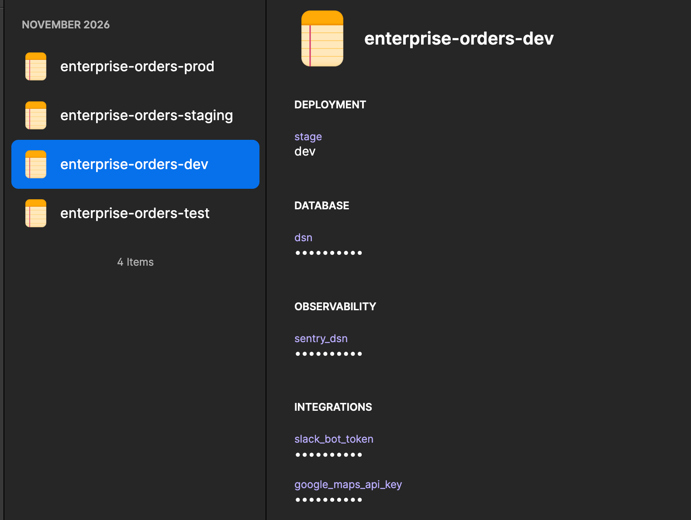

# Use 1Password vault items with `.env` and JSON

[Back to the 1Password Environments quickstart](../README.md)

If your team stores credentials in a 1Password vault, `op` can resolve
`op://` references from a checked-in template. The demo uses one Secure Note
per stage. It supports `.env` references for apps that read environment
variables and a JSON template for apps that read structured config. These
items live in a vault. The [quickstart](../README.md) uses 1Password
Environments under **Developer → View Environments**.



Both [`DATABASE_DSN` in the dotenv template](../.env.example) and
[`database.dsn` in the JSON template](../config.example.json) point to the
`dsn` field in the selected item's **Database** section.

## Try it locally

Complete the first two steps of the [quickstart](../README.md#run-the-demo-locally)
to connect your CLI to the desktop app.
Run the commands below in Bash or Zsh from the repository root.

One teammate chooses a test vault the developers can access and has permission
to create items in it. For a solo trial, choose a writable vault in your own
account. Set `OP_DEMO_VAULT` to that vault's name or ID. The loop creates only
missing demo items and pipes synthetic values directly to 1Password.

```sh
export OP_DEMO_VAULT='PASTE_DEMO_VAULT_NAME_OR_ID'
(
  set -o pipefail
  existing=$(op item list --vault "$OP_DEMO_VAULT" --format=json |
    python3 -c 'import json, sys; print("\n".join(item["title"] for item in json.load(sys.stdin)))') || exit 1
  for stage in test dev staging prod; do
    if grep -Fxq -- "enterprise-orders-$stage" <<< "$existing"; then
      continue
    fi
    python3 seed_demo.py "$stage" --format item |
      op item create --vault "$OP_DEMO_VAULT" - >/dev/null || exit 1
  done
)
```

Each developer sets the same `OP_DEMO_VAULT` value in their terminal. Run
either command using the reference templates supplied in the repository.

### `.env` references

```sh
APP_ENV=dev op run --env-file=.env.example -- python3 app.py --stage dev
```

`APP_ENV` selects the item in the reference. `op run` resolves its fields and
passes them as environment variables. The template stays a reference file.
[1Password CLI environment variables](https://www.1password.dev/cli/secrets-environment-variables)

### JSON template

```sh
(
  set -o pipefail
  APP_ENV=staging op inject --in-file=config.example.json |
    python3 app.py --stage staging --config -
)
```

`op inject` writes plaintext JSON to stdout. Keep the pipe attached so the
app reads it directly from stdin. If your app requires a file, use `--out-file`
in a private temporary directory with mode `0600` for the file and remove it
when the app no longer needs it. Real values with quotes or backslashes may
require JSON escaping.
[1Password CLI config templates](https://www.1password.dev/cli/secrets-config-files)

Both commands print the summary from the quickstart, starting with
`Stage: DEV` or `Stage: STAGING` respectively.

## Use a team vault in your project

Store the fields in a vault shared with the developers who need them. Keep
the reference templates in Git and point them at your own vault, item, and
field names. If you need different access for different stages, put each
stage's credentials in its own vault and set the vault selector accordingly.
All four items in this synthetic demo share one vault's access permissions.
